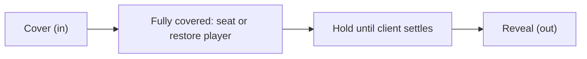

# Screen Transitions and Native Client GPU Interpolation in Pixelay

Pixelay provides two layers of animation and transition technologies:
1. **Native Client GPU Interpolation (High Refresh Rate)**: Sub-tick GPU interpolation of transforms (`scale`, `translate`, `rotate`) on Display entities at monitor refresh rate.
2. **Screen Transitions**: Two-phase entry and exit transitions (fade, linear wipes, diagonal corner wipes, curtain) drawn with packet display panels or core shaders.

---

## 1. Native Client-Side GPU Interpolation (Uncapped Refresh Rates)

### Why Display Entities Stutter at 20 FPS
In vanilla Minecraft, the server ticks 20 times per second (50 ms per tick).
When a plugin recalculates entity positions on every server tick:
- The server sends updates at most 20 times per second.
- On a high-refresh monitor (such as 144 Hz or 240 Hz), movement looks stepped.
- When `transformation_interpolation_duration` is 0, the client snaps immediately to each packet and skips GPU interpolation.

### How Pixelay Interpolates at Monitor Refresh Rates
Minecraft 1.19.4+ Display entities (`TextDisplay`, `ItemDisplay`, `BlockDisplay`) support sub-tick interpolation across render frames:
1. When a property changes (such as `:hover`, `:selected`, or `.scale(1.04)`), Pixelay calculates the duration in ticks:
   $$\text{durationTicks} = \max\left(1, \operatorname{round}\left(\frac{\text{durationMs}}{50}\right)\right)$$
2. Pixelay sends the target transformation matrix immediately:
   - `transformation_interpolation_duration = durationTicks`
   - `transformation_start_delta = 0`
3. The client `DisplayRenderer` interpolates between the current matrix and the target matrix on every GPU render frame using `partialTicks`.
4. The frame rate matches the monitor:
   - **60 Hz**: ~12 interpolated frames for a 200 ms transition
   - **144 Hz**: ~29 interpolated frames
   - **240 Hz**: ~48 interpolated frames
   - **360 Hz**: ~72 interpolated frames
   All frames render on the GPU with no network overhead and no server CPU load during movement.

### How to Use Transitions in Pixelay Layouts

Transitions in Pixelay follow CSS syntax:

```java
Box<?> card = Layout.column(
        Layout.text(viewer, 24, "<b>Interactive Card</b>"),
        Layout.text(viewer, 18, "Floats upward and scales on hover")
    )
    .padding(20)
    .background(0xFFFFFFFF)
    .border(2, "#E2E8F0")
    // Define target style on :hover
    .state(State.HOVERED, s -> s
        .scale(1.04)
        .translateY(-4)
        .borderColor("#6366F1")
    )
    // 180 ms transition (translates to 4 ticks of client GPU interpolation)
    .transition(180, Easing.EASE_OUT);
```

#### Transitioning Specific Properties
You can transition all properties or target specific properties:

```java
// Transitions all properties (transform and background)
.transition(200)

// Transitions only the transform (scale/translate/rotate)
.transition(Transition.Property.TRANSFORM, 200, Easing.EASE_OUT)

// Transitions only background color
.transition(Transition.Property.BACKGROUND, 250, Easing.EASE)
```

---

## 2. Screen Transitions (Fade In and Fade Out)

When opening or closing full-screen sessions (`ScreenSession`), instant switching can look abrupt. Pixelay provides built-in screen transitions.

### Using ScreenSession Transitions

Configure transitions directly on `ScreenSession.Builder`:

```java
ScreenSession session = ScreenSession.builder(player)
    .camera(eyeLocation)
    .resolution(1920, 1080)
    // 250ms fade-in from black when entering, 200ms fade-out to black when closing
    .fadeIn(250)
    .fadeOut(200)
    .content(canvas -> MyScreen.build(player))
    .open();
```

Or configure both phases at once:

```java
.transition(ScreenTransition.fade(200))
```

### Transition Types

`ScreenTransition` provides these transition types:
- `ScreenTransition.fade(durationMs)` — Darkens the screen, then reveals the content. Default color is pure black (`#000000`).
- `ScreenTransition.linearWipe(durationMs, direction, color, easing)` — A panel sweeps across the screen. The direction is `LINEAR_WIPE_LEFT`, `LINEAR_WIPE_RIGHT`, `LINEAR_WIPE_UP`, or `LINEAR_WIPE_DOWN`.
- `ScreenTransition.cornerWipe(durationMs, corner, color, easing)` — A 45-degree edge sweeps diagonally from a corner. The corner is `CORNER_WIPE_TOP_LEFT`, `CORNER_WIPE_TOP_RIGHT`, `CORNER_WIPE_BOTTOM_LEFT`, or `CORNER_WIPE_BOTTOM_RIGHT`.
- `ScreenTransition.curtain(durationMs)` — Two halves close from the sides and open back out.

### How It Operates

Every transition has two phases of length `durationMs`, with a black hold between them:



#### Core Shader Transitions (Resource Pack)
When the Pixelay resource pack is active:
- **Full-Screen 2D GUI Layer**: Pixelay sends a title glyph (`\uE000` with font `pixelay:transition`). The vertex shader `rendertype_text.vsh` expands it to full-screen coordinates. Because Minecraft renders titles late in the 2D GUI pass, the transition draws above the first-person hand and the HUD.
- **No World Entities**: The server spawns no 3D entities in world blocks for shader transitions. The player sees no black billboard in the world.
- **GPU Sub-Tick Interpolation**: The client interpolates title alpha on every video frame. GLSL smoothstep anti-aliases edges cleanly.
- **Screen Masking**: Player teleportation and game mode changes occur when the screen is 100% black. The client shows no sudden hand or HUD disappearance.

#### Entity Fallback (`ScreenFader`)
When the client does not use the resource pack:
- The transition uses packet-level `TextDisplay` background panels (`ScreenFader`).
- Panels use a 1.6× safety margin to cover ultrawide monitors and high FOV settings.
