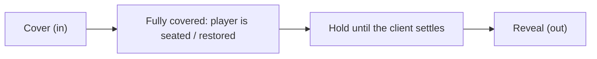

# Screen Transitions & Native Client GPU Interpolation in Pixelay

Pixelay provides two distinct layers of animation and transition technologies:
1. **Native Client GPU Interpolation (Unlimited / High-Refresh FPS)**: Sub-tick hardware GPU interpolation of transforms (`scale`, `translate`, `rotate`) on Display entities, running at the player's full monitor refresh rate (60 Hz, 144 Hz, 240 Hz, 360 Hz+).
2. **Screen Transitions**: Two-phase entry and exit transitions (fade, linear wipes, diagonal corner wipes, curtain) drawn with packet-only display panels.

---

## 1. Native Client-Side GPU Interpolation (Unlimited FPS)

### Why Display Entities Normally Stutter at 20 FPS
In vanilla Minecraft, the server ticks at 20 TPS (50 ms per tick). If a plugin attempts to animate position or size by recalculating values and updating entity metadata on every server tick:
- The server sends intermediate steps at most 20 times per second.
- On a 60 Hz, 144 Hz, 240 Hz, or 360 Hz monitor, the animation appears choppy and stepped, like a 20 FPS slideshow.
- Setting `transformation_interpolation_duration = 0` forces the client to snap immediately to each packet, completely bypassing the client's internal GPU interpolation engine.

### How Pixelay Achieves Monitor-Refresh Smoothness
Minecraft 1.19.4+ Display entities (`TextDisplay`, `ItemDisplay`, `BlockDisplay`) natively support GPU sub-tick interpolation across render frames:
1. When a property changes (such as `:hover`, `:selected`, or `.scale(1.04)`), Pixelay calculates the transition duration in ticks:
   $$\text{durationTicks} = \max\left(1, \operatorname{round}\left(\frac{\text{durationMs}}{50}\right)\right)$$
2. Instead of recalculating intermediate steps on the server every tick, Pixelay immediately sends the **final target transformation matrix** with:
   - `transformation_interpolation_duration` = `durationTicks`
   - `transformation_start_delta` = `0`
3. The Minecraft client's `DisplayRenderer` interpolates between the current transformation matrix and target matrix on **every single video frame rendered by the GPU** using `partialTicks`.
4. The frame rate is completely **uncapped** and matches the player's monitor:
   - **60 Hz**: ~12 interpolated frames for a 200 ms transition
   - **144 Hz**: ~29 interpolated frames
   - **240 Hz**: ~48 interpolated frames
   - **360 Hz**: ~72 interpolated frames
   All rendered on the GPU with zero network overhead and zero server CPU load during the animation.

### How to Use Transitions in Pixelay Layouts

Transitions in Pixelay follow CSS syntax:

```java
Box<?> card = Layout.column(
        Layout.text(viewer, 24, "<b>Interactive Card</b>"),
        Layout.text(viewer, 18, "Floats upward and scales on hover")
    )
    .padding(20)
    .background(0xFFFFFFFF)
    .border(2, "#E2E8F0")
    // Define target style on :hover
    .state(State.HOVERED, s -> s
        .scale(1.04)
        .translateY(-4)
        .borderColor("#6366F1")
    )
    // 180 ms smooth transition (translates to 4 ticks of client GPU interpolation)
    .transition(180, Easing.EASE_OUT);
```

#### Transitioning Specific Properties
You can transition all properties or target specific ones:

```java
// Transitions all properties (transform and background)
.transition(200)

// Transitions only the transform (scale/translate/rotate)
.transition(Transition.Property.TRANSFORM, 200, Easing.EASE_OUT)

// Transitions only background color
.transition(Transition.Property.BACKGROUND, 250, Easing.EASE)
```

---

## 2. Screen Transitions (Fade In & Fade Out)

When opening or closing full-screen sessions (`ScreenSession`), instant popping can feel abrupt. Pixelay supports built-in screen transitions.

### Using ScreenSession Transitions

Configure transitions directly on the `ScreenSession.Builder`:

```java
ScreenSession session = ScreenSession.builder(player)
    .camera(eyeLocation)
    .resolution(1920, 1080)
    // 250ms fade-in from black when entering, 200ms fade-out to black when closing
    .fadeIn(250)
    .fadeOut(200)
    .content(canvas -> MyScreen.build(player))
    .open();
```

Or configure both at once:

```java
.transition(ScreenTransition.fade(200))
```

### Transition Types

Defined in `ScreenTransition` (each with a configurable duration, overlay color and easing):
- `ScreenTransition.fade(durationMs)` — smooth darken, then smooth reveal (default: pure black `#000000`).
- `ScreenTransition.linearWipe(durationMs, direction, color, easing)` — a panel sweeps across the screen; `direction` is one of `LINEAR_WIPE_LEFT`, `LINEAR_WIPE_RIGHT`, `LINEAR_WIPE_UP`, `LINEAR_WIPE_DOWN`.
- `ScreenTransition.cornerWipe(durationMs, corner, color, easing)` — a straight edge turned 45° sweeps diagonally from a corner; `corner` is one of `CORNER_WIPE_TOP_LEFT`, `CORNER_WIPE_TOP_RIGHT`, `CORNER_WIPE_BOTTOM_LEFT`, `CORNER_WIPE_BOTTOM_RIGHT`.
- `ScreenTransition.curtain(durationMs)` — two halves close in from the sides, then open back out.

### How It Works

Every transition has two phases, each lasting `durationMs`, with a black hold in between:



- **Opening from the world**: a veil spawned right in front of the player's eyes covers the world; behind it the player is teleported, switched to spectator and mounted on the camera, and a veil over the canvas appears before any content. After a short hold the veil reveals the screen.
- **Closing**: a veil covers the screen; behind it the player is restored to their previous location and game mode, a veil in front of their eyes takes over, and after the hold it reveals the world.
- **Switching screens** (`session.close(() -> openNext())`): the old screen covers, the new one starts covered and only reveals; the view never returns to the player in between.

A wipe keeps moving in one direction through both phases: it enters from one side while covering and leaves through the opposite side while revealing.

The veil is drawn as `TextDisplay` background panels (`ScreenFader`), larger than the canvas so it also covers wider-than-16:9 screens and higher fields of view. No resource pack or shader is needed.
