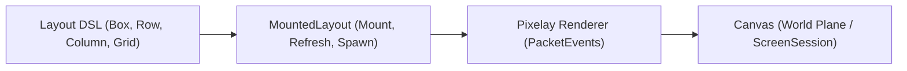

# Architecture & Pipeline

Pixelay provides a clean, modular API for Minecraft Paper 1.21+ user interfaces.

## Section Overview

- [Canvas & World Placement](canvas-and-world-placement.md) — Create canvas planes, set world positions, and inspect canvas dimensions.
- [Rendering Modes & Performance](display-entities-and-packet-renderer.md) — Compare packet-based fake entities with server entities.
- [Depth Layering & Z-Index](depth-layering-and-z-index.md) — Use `.zIndex(int)` and document order to stack UI elements.
- [Colors & Translucency Guidelines](porter-duff-alpha-compositing.md) — Color formats, alpha transparency, and background practices.
