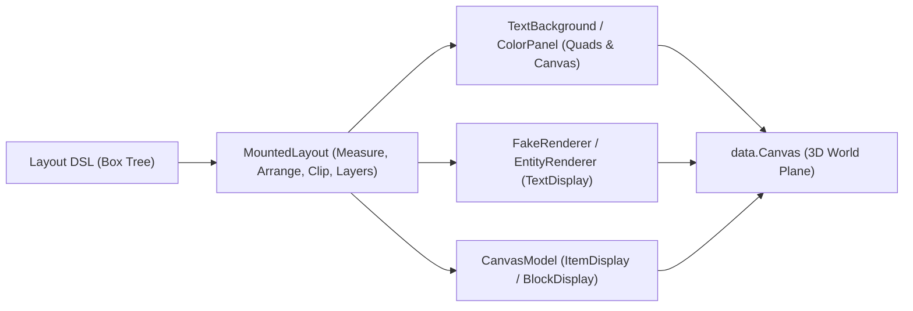

# Architecture & Rendering Pipeline

Pixelay divides spatial projection, layout calculation, and rendering into distinct layers.

---

## 1. Spatial Projection (`dev.horuse.pixelay.data.Canvas`)

`dev.horuse.pixelay.data.Canvas` defines an oriented 2D pixel coordinate system `(0..pixelWidth, 0..pixelHeight)` mapped onto a 3D plane in a Minecraft world:
- **Origin `(0, 0)`** is the top-left corner of the surface.
- **`+X`** points right across the surface. **`+Y`** points down. **`+Z` (`depth`)** points outward along the surface normal toward the viewer.
- The canvas supports 3D orientation (`yaw`, `pitch`, `roll`) with quaternion basis vectors (`right`, `up`, `normal`).

---

## 2. Depth Layering (`Layers`) and `z-index`

Minecraft sorts translucent `TextDisplay` entities by camera distance in OpenGL. When two surfaces share one depth plane, z-fighting occurs.

Pixelay resolves this problem in `MountedLayout.assignSteps()`:
1. Pixelay collects each `Box` in DOM painting order (parents before children, earlier siblings before later siblings) and sorts by `Box.zIndex()`.
2. Each box specifies its required depth steps (`layerSteps()`):
   - Standard `Box`, `Container`, `Item`, `Block`: 1 step (its background or 3D model).
   - `Text`, `Button`: 2 steps (step `N` for its background panel, step `N + 1` for the glyph above it).
   - `layout.Canvas`: 2 steps (step `N` for its background panel, step `N + 1` for greedy-meshed pixel quads).
3. If a box overlaps an earlier painted box, Pixelay sets its `paintStep` strictly above `earlier.paintEnd + 1`.

---

## 3. Porter-Duff Alpha Compositing (`MountedLayout.composite`)

In vanilla Minecraft, rendering a semi-transparent `TextDisplay` in front of an opaque `TextDisplay` writes to the depth buffer. This action creates a translucent hole into the world blocks behind both entities.

Pixelay resolves this artifact automatically:
- During `syncBackgrounds()`, `MountedLayout` calculates the effective ARGB background of each `Box`.
- When a box has a semi-transparent background (`0 < alpha < 255`), Pixelay finds the nearest overlapping ancestor or underlying sibling background. Pixelay blends them with the Porter-Duff Source Over operator (`MountedLayout.composite(bgUnder, bgOver)`).
- When an ancestor has an opaque background (`alpha == 255`), all translucent cards, hover highlights, scrollbars, and canvas pixels over it composite into an opaque color. This stops depth-buffer bleed-through.

---

## 4. In-Place Packet Updates (`ColorPanel` and `TextBackground`)

`ColorPanel` scales a single-space `TextDisplay` (`5 × 10` font px) to an arbitrary pixel rectangle `(x, y, width, height)`.
- When a `TextBackground` moves, resizes, or changes color (such as during scrolling or a hover color transition), `ColorPanel.update(...)` updates `scale`, `translation`, and `backgroundColor` in a single packet (`WrapperPlayServerEntityMetadata`) with `transformationDuration = 0`.
- The server does not destroy and recreate entities on color or bounds changes. This prevents client flicker and interpolation lag.

---

## 5. Full-Screen Sessions (`ScreenSession`)

`ScreenSession` converts a `MountedLayout` into a full-screen interface for a player:
- The session locks the player in spectator mode onto an invisible `ScreenCamera` facing the surface.
- The session maps client look packets (`yaw`, `pitch`) directly to `(cursorX, cursorY)` canvas pixels with perspective trigonometry (`halfHeightTan`).
- **Core Shader Cursor (`ShaderCursor`)**: When the resource pack is active, the client vertex shader (`rendertype_text`) renders the cursor on the GPU at monitor frame rate with zero network latency. The shader switches sprites based on the CSS `cursor` property of the hovered `Box`.
- The server updates smooth scrolling (`ScrollView`), CSS property transitions (`Transition`), scrollbar dragging, and canvas brush strokes every server tick (20 Hz). The server packages all entity updates into a single bundle (`PacketUtils.sendBundle`).
