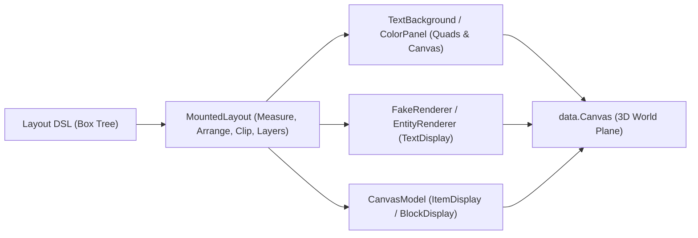

# Architecture & Rendering Pipeline

Pixelay separates **spatial projection**, **layout calculation**, and **entity/packet rendering** into clean, single-responsibility layers following SOLID principles.

---

## 1. Spatial Projection (`dev.horuse.pixelay.data.Canvas`)

`dev.horuse.pixelay.data.Canvas` defines an oriented 2D pixel coordinate system `(0..pixelWidth, 0..pixelHeight)` mapped onto a 3D plane in a Minecraft world:
- **Origin `(0, 0)`** is the top-left corner of the surface.
- **`+X`** runs right across the surface; **`+Y`** runs down; **`+Z` (`depth`)** steps out toward the viewer along the surface normal.
- Supports arbitrary 3D orientation (`yaw`, `pitch`, `roll`) via quaternion basis vectors (`right`, `up`, `normal`).

---

## 2. Depth Layering (`Layers`) & `z-index`

Minecraft's OpenGL renderer sorts translucent `TextDisplay` entities by camera distance. When two surfaces share the same depth plane, z-fighting occurs.

Pixelay solves this deterministically in `MountedLayout.assignSteps()`:
1. Every `Box` in the tree is collected in DOM painting order (parents before children, earlier siblings before later siblings) and stably sorted by `Box.zIndex()`.
2. Each box declares how many depth steps it requires (`layerSteps()`):
   - Standard `Box` / `Container` / `Item` / `Block`: `1` step (its background or 3D model).
   - `Text` / `Button`: `2` steps (step `N` for its background panel, step `N + 1` for the `TextDisplay` glyph above it).
   - `layout.Canvas`: `2` steps (step `N` for its background panel, step `N + 1` for its greedy-meshed pixel quads).
3. If a box's rectangle overlaps any earlier painted box, its `paintStep` is placed strictly above `earlier.paintEnd + 1`.

---

## 3. Porter-Duff Alpha Compositing (`MountedLayout.composite`)

In vanilla Minecraft, rendering a semi-transparent `TextDisplay` in front of an opaque `TextDisplay` writes to the depth buffer and punches a translucent hole straight through to the world blocks behind both entities.

Pixelay eliminates this artifact automatically:
- During `syncBackgrounds()`, `MountedLayout` computes the effective ARGB background of each `Box`.
- If a box's background is semi-transparent (`0 < alpha < 255`), Pixelay locates the nearest overlapping ancestor or underlying sibling background and blends them using the **Porter-Duff `Source Over`** operator (`MountedLayout.composite(bgUnder, bgOver)`).
- Whenever any ancestor has an opaque background (`alpha == 255`), all translucent cards, hover highlights, scrollbars, and `layout.Canvas` pixels over it are guaranteed to composite into a `100%` opaque colour, completely preventing depth-buffer bleed-through.

---

## 4. In-Place Packet Updates (`ColorPanel` & `TextBackground`)

`ColorPanel` stretches a single-space `TextDisplay` (`5 × 10` font px) to any arbitrary pixel rectangle `(x, y, width, height)`.
- When a `TextBackground` moves, resizes, or changes colour (such as during smooth scrolling or a CSS `:hover` colour transition), `ColorPanel.update(...)` updates the `scale`, `translation`, and `backgroundColor` metadata in a **single packet** (`WrapperPlayServerEntityMetadata`) with `transformationDuration = 0`.
- Entities are never destroyed and respawned on colour/bounds changes, eliminating client-side flicker and teleport interpolation lag.

---

## 5. Full-Screen Sessions (`ScreenSession`)

`ScreenSession` turns a `MountedLayout` into a full-screen GUI for a single player:
- Locks the player in spectator mode onto an invisible `ScreenCamera` facing the surface.
- Maps client look packets (`yaw`, `pitch`) directly to `(cursorX, cursorY)` canvas pixels using exact perspective trigonometry (`halfHeightTan`).
- **Core Shader Cursor (`ShaderCursor`)**: When the generated resource pack is active, the cursor is rendered directly on the GPU by the client's `rendertype_text` vertex shader at full client framerate (zero network latency) and automatically switches sprites based on the CSS `cursor` property of the hovered `Box`.
- Ticks smooth scroll animations (`ScrollView`), CSS property transitions (`Transition`), scrollbar thumb dragging, and continuous `layout.Canvas` brush strokes every server tick (20 Hz), wrapping all entity updates in a single packet bundle (`PacketUtils.sendBundle`).
